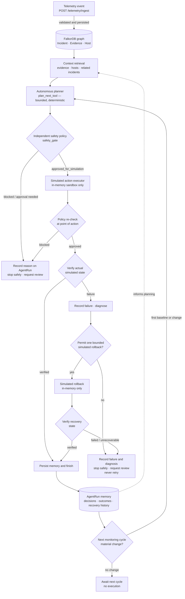

# Eclipse AI

**An autonomous, graph-grounded incident response agent with safety-gated simulation.**

[](https://www.python.org/)
[](https://fastapi.tiangolo.com/)
[](https://docs.falkordb.com/)
[](#safety-model)
[](#testing-and-evidence)

Eclipse AI ingests security telemetry, grounds every decision in a **FalkorDB context graph**, plans a **bounded** next step, and executes it **only inside an in-memory simulator** — after an independent safety policy says yes. Every decision, stop reason, verification result, and rollback is persisted back to the graph as durable memory that informs the next cycle.

> **Safety notice:** Eclipse AI **cannot change real hosts or networks**. The executor, rollback, and verification stages operate on a process-local, in-memory simulator (`_SIMULATED_HOST_STATE` in [`app.py`](app.py)). `real_world_actions_enabled` is hard-coded `false` in every response, and an emergency kill switch blocks all execution. This is a research and demo system, not production remediation.

---

## Table of contents

- [The problem](#the-problem)
- [The solution](#the-solution)
- [Project status](#project-status)
- [Architecture](#architecture)
- [Closed-loop lifecycle](#closed-loop-lifecycle)
- [Safety model](#safety-model)
- [Live walkthrough](#live-walkthrough)
- [Technology stack](#technology-stack)
- [Quick start (Windows PowerShell)](#quick-start-windows-powershell)
- [Configuration](#configuration)
- [Testing and evidence](#testing-and-evidence)
- [API reference](#api-reference)
- [Monitoring and bounded autonomy](#monitoring-and-bounded-autonomy)
- [Known limitations](#known-limitations)
- [Roadmap](#roadmap)
- [Repository layout](#repository-layout)
- [Contributing](#contributing)
- [License](#license)

---

## The problem

Security teams are drowning in alerts, and the tempting fix — "let an AI agent fix it" — is exactly the wrong default. An agent that can quarantine a host can also quarantine the wrong host, retry a failed action forever, or act on stale evidence. Trust is destroyed the first time autonomy outruns verification.

Most agent frameworks fail in one of two directions: they are either pure chat (no durable state, no verification) or fully autonomous (policy bolted on as an afterthought, actions against real infrastructure).

## The solution

Eclipse AI separates four responsibilities that are usually fused together:

| Responsibility | Owner in Eclipse AI | Why it is separate |
| --- | --- | --- |
| Choosing the next step | Deterministic planner ([`plan_next_tool`](app.py)) | Replans after every observation; never executes a precomputed plan blindly |
| Permitting the step | Independent safety policy ([`safety_gate`](app.py)) | Re-evaluated at the point of action; the planner cannot grant itself permission |
| Performing the step | Simulated executor ([`simulated_executor`](app.py)) | In-memory only; the only action code path in the system |
| Judging the outcome | Independent verifier ([`verify_simulation`](app.py)) | Reads the simulator state directly instead of trusting the executor's response |

Durable memory closes the loop: every run is persisted to FalkorDB as an `AgentRun` node with its decision trace, stop reason, verification result, and recovery history, and the next planning cycle reads that history back ([`retrieve_agent_memory`](app.py)).

**What makes it distinctive:** planning and safety are independent code paths, verification never trusts the actor, autonomy is bounded and stoppable through an API, and the entire loop is grounded in a queryable graph rather than prompt context.

## Project status

Everything in the **Implemented** column is present in [`app.py`](app.py) and covered by [`test_app.py`](test_app.py) or verified in a live session.

| Capability | Status | Evidence |
| --- | --- | --- |
| Telemetry ingestion with validation, idempotency, and conflict rejection | Implemented | [`/telemetry/ingest`](app.py), live-verified |
| Graph-grounded triage and context retrieval | Implemented | [`/triage`](app.py), [`/agent/context`](app.py), live-verified |
| Deterministic bounded planner | Implemented | [`plan_next_tool`](app.py), unit-tested |
| Independent safety policy (allowlist, severity, confidence, sandbox, kill switch) | Implemented | [`safety_gate`](app.py), unit-tested |
| Simulated executor + independent verification | Implemented | [`verify_simulation`](app.py), unit-tested |
| One bounded simulated rollback and re-verification | Implemented | [`simulated_recovery`](app.py), unit-tested |
| Durable run memory and recovery history in FalkorDB | Implemented | [`persist_agent_run`](app.py), live-verified |
| Change-detection monitoring cycle | Implemented | [`monitor_cycle`](app.py), live-verified |
| Bounded background autonomy loop with start/stop controls | Implemented | [`_autonomy_worker`](app.py), unit-tested + live-verified |
| Real-world remediation | **Not implemented — by design** | No such code path exists |
| LLM-based planner | Not implemented | The planner is a deterministic goal-state function |
| AuthN/AuthZ, TLS termination, multi-worker simulator | Not implemented | See [Known limitations](#known-limitations) |

## Architecture



### Closed-loop lifecycle

Each stage maps to real code. Nothing in this list is aspirational.

1. **Event & telemetry ingestion** — [`POST /telemetry/ingest`](app.py) validates the event with Pydantic (`severity` must match `low|medium|high|critical`, `confidence` in `[0,1]`, `environment` in `sandbox|production`) and persists the incident, evidence, and host nodes plus their relationships. Identical re-submitted events are idempotent; a conflicting `event_id` reuse returns `409`.
2. **FalkorDB context graph** — [`get_related_graph_context`](app.py) retrieves the incident's evidence, hosts, and related incidents that share a host; [`retrieve_agent_memory`](app.py) retrieves prior runs, verification outcomes, and recovery history. If memory is unavailable, the run continues under current-run evidence only — memory failure never bypasses the safety gate.
3. **Autonomous planner** — [`plan_next_tool`](app.py) picks the next tool from the current observation and completed-tool history: `inspect_incident → safety_gate → simulated_executor → verify_simulation`, or on failure `diagnose_failure → recovery → verify_recovery → stop`. It is a deterministic goal-state planner, not an LLM, and it re-plans after every step.
4. **Independent safety policy** — [`safety_gate`](app.py) is a separate function the planner cannot influence. It enforces the action allowlist, severity, confidence, sandbox-only, and kill-switch rules. It runs once before execution and is **re-checked immediately before the action** ([`app.py`](app.py)) so a kill switch flipped mid-run still blocks.
5. **Simulated action executor** — [`simulated_executor`](app.py) applies `isolate_demo_host` to the in-memory `_SIMULATED_HOST_STATE` dict only. There is no other execution path in the codebase.
6. **Verify actual simulated state** — [`verify_simulation`](app.py) reads `_SIMULATED_HOST_STATE` directly and confirms the response claims (`real_host_changed: false`, sandbox target) rather than trusting the executor's report.
7. **Persist memory and finish** — [`persist_agent_run`](app.py) writes an `AgentRun` node with status, execution result, verified flag, full step log, decision trace, stop reason, and recovery flag, linked to the incident via `INVESTIGATED`.
8. **Next monitoring cycle** — [`monitor_cycle`](app.py) fingerprints the graph-grounded state (severity, status, evidence, related incidents) and compares it with the previous stored `MonitorCycle` node: `baseline_observed` on first sight, `rerun_triage` on material change, `continue_monitoring` otherwise. It never executes anything itself.

### Safe branches

| Branch | Trigger | Behavior | Terminal state |
| --- | --- | --- | --- |
| Approved for simulation | Safety gate passes | Execute in simulator → verify actual state → persist | `simulation_verified` |
| Blocked / approval needed | Severity, confidence, sandbox, allowlist, or kill-switch failure | Record the blocking reasons, do not execute, stop | `blocked_pending_review` |
| Verification failure | Simulator state does not match the expected outcome | Record failure, diagnose, permit **at most one** bounded rollback, re-verify | `recovery_verified` |
| Recovery failed / unrecoverable | Rollback cannot be verified | Persist the failure and diagnosis, stop safely, request review — the action is never retried | `verification_failed` |
| Execution budget exhausted | `max_steps` reached before a terminal state | Stop safely with `step_limit_reached` | `step_limit_reached` |
| No material change | Monitoring fingerprint unchanged | Await the next cycle; no agent run, no execution | `continue_monitoring` |

## Safety model

Every control below is enforced in code, not by convention.

| Control | Implementation | Detail |
| --- | --- | --- |
| Action allowlist | [`safety_gate`](app.py) | Only `isolate_demo_host` is ever proposed or permitted |
| Severity threshold | [`safety_gate`](app.py) | Incident severity must be `high` |
| Confidence threshold | [`safety_gate`](app.py) | At least one evidence item must have `confidence >= 0.90` |
| Sandbox-only operation | [`safety_gate`](app.py) | Every affected host must be in the `sandbox` environment |
| Emergency kill switch | [`safety_gate`](app.py) | `ECLIPSE_KILL_SWITCH` in `1/true/yes/on` blocks all execution |
| Defence in depth | [`app.py`](app.py) | The gate is re-evaluated at the point of action; a flip mid-run still blocks |
| Bounded execution | [`AgentRunRequest`](app.py) | `max_steps` limited to 1–20; the loop breaks on any terminal state |
| Bounded recovery | [`plan_next_tool`](app.py) | Exactly one rollback is proposed; the failed action is never re-executed |
| Independent verification | [`verify_simulation`](app.py) | Reads simulator state directly instead of trusting the executor |
| Stoppable autonomy | [`/agent/autonomy/stop`](app.py) | Sets a stop event, waits up to 12 s for the current cycle, then cancels |
| No silent resume | [`app.py`](app.py) | Autonomy never restarts itself; it must be started through the API |
| Simulation-only responses | every route | `simulation_only: true` and `real_world_actions_enabled: false` are hard-coded |

## Live walkthrough

The session below was captured on **2026-10-17** against a running instance of this exact codebase connected to a live FalkorDB graph. Identifiers are sandbox demo values.

```powershell
# 1. Ingest a simulated high-severity event
POST /telemetry/ingest
{ "event_id": "EVT-README-61A3A241-A", "incident_id": "INC-README-61A3A241",
  "event_type": "suspicious_process", "severity": "high", "confidence": 0.97,
  "source": "readme-demo", "host_name": "sandbox-readme-61A3A241",
  "environment": "sandbox" }

→ 201 { "accepted": true, "duplicate": false, "simulation_only": true, ... }
```

```jsonc
// 2. Triage — graph-grounded policy preview (nothing executes here)
POST /triage  { "incident_id": "INC-README-61A3A241" }
{
  "severity": "high",
  "evidence": [{ "type": "suspicious_process", "confidence": 0.97,
                 "host": "sandbox-readme-61A3A241", "environment": "sandbox" }],
  "reasoning": { "high_confidence_evidence": true,
                 "all_affected_hosts_in_sandbox": true,
                 "decision_explanation": ["Severity, confidence, and sandbox checks passed."] },
  "policy_decision": "approved_for_simulation",
  "proposed_action": "isolate_demo_host",
  "execution": "not_executed"
}
```

```jsonc
// 3. Bounded agent run — approved → execute → verify
POST /agent/run  { "incident_id": "INC-README-61A3A241", "max_steps": 6 }
{
  "run_id": "12563fbf-6912-42a7-8e26-12e7ba301f39",
  "agent_status": "simulation_verified",
  "execution": "simulated_success",
  "verified": true,
  "recovery_attempted": false,
  "memory_persisted": true,
  "stop_reason": "The simulated action met the verification goal.",
  "steps": [ "inspect_incident", "safety_gate", "simulated_executor", "verify_simulation" ]
}
```

```jsonc
// 4. Same run with the test-only fault injection — failure → diagnose → one rollback → re-verify
POST /agent/run  { "incident_id": "INC-README-61A3A241", "max_steps": 8,
                   "simulate_verification_failure": true }
{
  "agent_status": "recovery_verified",
  "execution": "simulated_recovered",
  "verified": true,
  "recovery_attempted": true,
  "stop_reason": "Recovery restored the simulator baseline and passed independent re-verification.",
  "steps": [ "inspect_incident", "safety_gate", "simulated_executor", "verify_simulation",
             "diagnose_failure", "recovery", "verify_recovery" ]
}
```

```jsonc
// 5. Material change detection — a second event on the same incident
POST /agent/monitor-cycle  { "incident_id": "INC-README-61A3A241" }
// cycle #1 (before the new event):  "change_detected": false, "decision": "baseline_observed"
// cycle #2 (after the new event):   "change_detected": true,  "decision": "rerun_triage"
//                                  "next_action": "Re-inspect changed graph evidence and
//                                   re-run the independent safety gate; do not auto-execute."
// cycle #3 (no further change):     "decision": "continue_monitoring"
```

```jsonc
// 6. Durable memory reflects both outcomes
GET /agent/memory?incident_id=INC-README-61A3A241
{ "available": true, "records_considered": 2, "verified_runs": 2,
  "verified_recoveries": 1,
  "memory_policy": "Historical records inform planning; safety policy is always re-evaluated independently." }
```

```jsonc
// 7. Background autonomy: started, observed one cycle, stopped cleanly
POST /agent/autonomy/start  { "incident_ids": ["INC-README-61A3A241"],
                              "interval_seconds": 15, "max_steps": 6 }
GET  /agent/autonomy/status   // cycles_completed: 1, agent_runs_started: 0,
                              // last_cycle.decision: "continue_monitoring",
                              // real_world_actions_enabled: false
POST /agent/autonomy/stop     // "Autonomy loop stopped safely."
```

Note step 7: the worker observed **no material change**, so it deliberately started **zero** agent runs. That is the intended behavior — autonomy is change-triggered, not continuous action.

## Technology stack

All versions verified from the project virtual environment (`pip freeze`, Python 3.14.3).

| Component | Version | Role |
| --- | --- | --- |
| Python | 3.14.3 (syntax requires 3.10+) | Runtime |
| FastAPI | 0.143.1 | API layer, request validation, OpenAPI/Swagger |
| Starlette | 1.8.0 | ASGI toolkit used by FastAPI |
| Uvicorn | 0.54.0 | ASGI server |
| Pydantic | 2.14.1 | Request schemas and validation |
| FalkorDB (Python client) | 1.8.0 | Graph database client |
| redis-py | 8.1.0 | Transport used by the FalkorDB client |
| python-dotenv | 1.2.4 | `.env` configuration loading |
| pytest / httpx | 9.1.1 / 0.28.1 | Test suite and FastAPI `TestClient` transport |

The dashboard at [`index.html`](index.html) is dependency-free vanilla HTML/JS served by `GET /`.

## Quick start (Windows PowerShell)

> Dependencies are declared in [`requirements.txt`](requirements.txt) with the versions verified in this environment. Installing from that manifest reproduces the setup exactly.

```powershell
# 1. Clone (origin remote as configured in this repository)
git clone https://github.com/khanadil84/Eclipse-AI.git
cd Eclipse-AI

# 2. Create the virtual environment
python -m venv .venv

# 3. Install dependencies from the verified manifest
.\.venv\Scripts\python.exe -m pip install -r requirements.txt

# 4. Configure — copy the template and edit in your own values
Copy-Item .env.example .env
notepad .env

# 5. Start the API (simulation-only agent, port 8000)
.\.venv\Scripts\python.exe -m uvicorn app:app --host 127.0.0.1 --port 8000
```

Open **Swagger UI at <http://127.0.0.1:8000/docs>** (ReDoc at `/redoc`, schema at `/openapi.json`).

> If PowerShell blocks script activation, you do not need `Activate.ps1` at all — invoking `.\.venv\Scripts\python.exe` directly works and is what the commands above do. If `ECLIPSE_KILL_SWITCH` was left enabled in `.env`, every agent run will be blocked until you set it to `false`.

Optional end-to-end script (PowerShell, uses the same endpoints as the walkthrough):

```powershell
.\demo.ps1
```

## Configuration

Configuration is read from `.env` via `python-dotenv`. **Never commit `.env`** — it is ignored by [`.gitignore`](.gitignore), and [`.env.example`](.env.example) contains only placeholders.

| Key | Required | Default | Purpose |
| --- | --- | --- | --- |
| `FALKORDB_HOST` | yes | — | FalkorDB hostname |
| `FALKORDB_PORT` | no | `54211` | FalkorDB port |
| `FALKORDB_USERNAME` | yes | — | FalkorDB username |
| `FALKORDB_PASSWORD` | yes | — | FalkorDB password |
| `FALKORDB_GRAPH` | no | `eclipse-ai` | Graph name |
| `ECLIPSE_KILL_SWITCH` | no | `false` | `1/true/yes/on` blocks every agent action before execution |

`FALKORDB_TLS` may appear in local environments, but the current [`get_graph()`](app.py) opens connections with `ssl=False` hardcoded — the key is **not read** by the application yet.

## Testing and evidence

```powershell
.\.venv\Scripts\python.exe -m pytest -v
```

**Actual result — 2026-10-17, this environment:**

```text
platform win32 -- Python 3.14.3, pytest-9.1.1, pluggy-1.7.0
collected 13 items

test_app.py::test_normal_run_executes_and_verifies_simulation PASSED
test_app.py::test_failed_verification_triggers_rollback_and_reverification PASSED
test_app.py::test_kill_switch_blocks_before_simulated_execution PASSED
test_app.py::test_safety_gate_rejects_non_allowlisted_action PASSED
test_app.py::test_invalid_request_is_rejected PASSED
test_app.py::test_planner_uses_observed_failure_and_historical_recovery PASSED
test_app.py::test_graph_context_returns_related_incident_evidence PASSED
test_app.py::test_monitor_cycle_persists_observation_without_execution PASSED
test_app.py::test_autonomy_status_is_simulation_only PASSED
test_app.py::test_autonomy_start_stop_lifecycle PASSED
test_app.py::test_autonomy_worker_runs_agent_on_baseline_then_honors_stop PASSED
test_app.py::test_unrecoverable_recovery_stops_safely PASSED
test_app.py::test_autonomy_worker_reruns_agent_on_material_change PASSED

======================= 13 passed, 1 warning in 23.21s =======================
```

The single warning is a `StarletteDeprecationWarning` from `fastapi/testclient.py` about the `httpx` transport — cosmetic, not a failure.

**Note on `test_connection.py`:** this is a *live connectivity script*, not a mocked test. Its executable logic sits inside `main()` behind an `if __name__ == "__main__":` guard, so importing or collecting it never opens a database connection. The suite collects and runs fully offline; all 13 tests in `test_app.py` are mocked. Run it explicitly with `.\.venv\Scripts\python.exe test_connection.py` when you want a real connectivity check (it prints `SUCCESS` and exits `0`, or prints a failure reason without credentials and exits nonzero).

### What each evidence class covers

| Class | Covers | Source |
| --- | --- | --- |
| Automated tests (13) | Planner sequencing, kill switch, allowlist rejection, fault-injected rollback + re-verification, unrecoverable-recovery stop, monitor-cycle persistence, material-change-triggered reruns, autonomy lifecycle | [`test_app.py`](test_app.py) |
| Live demo (2026-10-17) | Real FalkorDB connectivity (graph `eclipse-ai`, node count read live during the session), ingestion, triage, both agent paths, material-change detection, durable memory, bounded autonomy with clean stop | Session captured above |
| Not verified / by design | Any real-world action, multi-worker simulator consistency, adversarial API abuse (no auth exists) | — |

## API reference

Interactive documentation: **<http://127.0.0.1:8000/docs>**. All routes below exist in [`app.py`](app.py).

| Method & path | Purpose | Key fields |
| --- | --- | --- |
| `GET /` | HTML dashboard | — |
| `GET /health` | Liveness probe | — |
| `GET /graph/status` | Graph connectivity + node count | — |
| `POST /triage` | Graph-grounded policy preview (never executes) | `incident_id` |
| `POST /telemetry/ingest` | Validate and persist event/evidence/host (201) | `event_id`, `incident_id`, `event_type`, `severity`, `confidence`, `source`, `host_name`, `environment` |
| `GET /agent/context/{incident_id}` | Related-incident context + historical memory | path param |
| `POST /agent/monitor-cycle` | One observation cycle; change detection only | `incident_id` |
| `POST /agent/run` | Bounded agent run | `incident_id`, `max_steps` (1–20), `simulate_verification_failure` |
| `GET /agent/memory` | Durable run/recovery history | `incident_id`, `limit` (1–50) |
| `GET /agent/runs` | Recent runs with decision traces | `incident_id?`, `limit` (1–100) |
| `POST /agent/autonomy/start` | Start bounded background loop | `incident_ids` (1–25), `interval_seconds` (15–3600), `max_steps` |
| `GET /agent/autonomy/status` | Loop state and safety boundary | — |
| `POST /agent/autonomy/stop` | Stop loop, wait for current cycle | — |

### Request/response examples

<details>
<summary><b>POST /telemetry/ingest</b> — 201 on success, 409 on conflicting reuse</summary>

```json
{
  "event_id": "EVT-DEMO-001",
  "incident_id": "INC-DEMO-001",
  "event_type": "suspicious_process",
  "severity": "high",
  "confidence": 0.97,
  "source": "demo",
  "host_name": "sandbox-demo-001",
  "environment": "sandbox"
}
```

```json
{
  "accepted": true,
  "duplicate": false,
  "simulation_only": true,
  "event_id": "EVT-DEMO-001",
  "incident_id": "INC-DEMO-001",
  "host_name": "sandbox-demo-001",
  "environment": "sandbox",
  "message": "Telemetry event persisted to FalkorDB."
}
```

</details>

<details>
<summary><b>POST /agent/run</b> — full response shape (abridged)</summary>

```json
{
  "run_id": "12563fbf-6912-42a7-8e26-12e7ba301f39",
  "incident_id": "INC-DEMO-001",
  "agent_status": "simulation_verified",
  "simulation_only": true,
  "execution": "simulated_success",
  "verified": true,
  "recovery_attempted": false,
  "memory_persisted": true,
  "stop_reason": "The simulated action met the verification goal.",
  "steps": [
    { "step": 1, "tool": "inspect_incident", "planner_reason": "Incident context has not been observed yet.",
      "observation": { "severity": "high", "evidence_count": 1, "policy_decision": "approved_for_simulation" },
      "graph_context": { "graph_grounded": true, "related_incident_count": 0 },
      "historical_memory": { "available": true, "records_considered": 0, "verified_recoveries": 0 } },
    { "step": 2, "tool": "safety_gate", "result": "approved", "reasons": [] },
    { "step": 3, "tool": "simulated_executor",
      "pre_execution_policy_recheck": { "approved": true, "reasons": [] },
      "result": { "action_id": "SIM-12563fbf", "action": "isolate_demo_host",
                  "target": "sandbox_demo_only", "result": "simulated_success",
                  "simulated_state": "isolated", "real_host_changed": false } },
    { "step": 4, "tool": "verify_simulation", "verified": true }
  ],
  "autonomy": { "mode": "bounded_observation_driven", "planner": "deterministic_goal_state",
                "max_steps": 6, "steps_used": 4, "human_safety_boundary": true,
                "real_world_actions_enabled": false, "decision_trace": [] }
}
```

`agent_status` is one of: `simulation_verified`, `recovery_verified`, `blocked_pending_review`, `verification_failed`, `step_limit_reached`.

</details>

<details>
<summary><b>POST /agent/monitor-cycle</b> — one observation, never executes</summary>

```json
{
  "cycle_id": "9116d46b-7ac0-4ed4-80e0-3622c50d40fc",
  "incident_id": "INC-DEMO-001",
  "observed_at": "2026-10-17T12:57:44.293019+00:00",
  "change_detected": true,
  "decision": "rerun_triage",
  "next_action": "Re-inspect changed graph evidence and re-run the independent safety gate; do not auto-execute.",
  "graph_context": { "graph_grounded": true, "related_incident_count": 0 },
  "memory_summary": { "available": true, "records_considered": 2, "verified_recoveries": 1 },
  "execution_performed": false,
  "real_world_actions_enabled": false
}
```

`decision` is one of `baseline_observed`, `rerun_triage`, `continue_monitoring`.

</details>

<details>
<summary><b>POST /agent/autonomy/start · GET /agent/autonomy/status · POST /agent/autonomy/stop</b></summary>

```json
// start
{ "incident_ids": ["INC-DEMO-001"], "interval_seconds": 15, "max_steps": 6 }
// → { "started": true, "running": true, "mode": "autonomous_simulation_only",
//     "real_world_actions_enabled": false, ... }

// status (observed live)
{ "running": true, "cycles_completed": 1, "agent_runs_started": 0,
  "last_cycle": { "decision": "continue_monitoring", "change_detected": false },
  "last_agent_run": null, "last_error": null,
  "real_world_actions_enabled": false }

// stop
// → { "stopped": true, "message": "Autonomy loop stopped safely.", "running": false }
```

</details>

## Monitoring and bounded autonomy

Two layers, both simulation-only:

- **`POST /agent/monitor-cycle`** performs exactly one observation per request. It compares a SHA-256 fingerprint of the graph-grounded incident state (severity, status, evidence set, related incidents) against the most recent stored `MonitorCycle` node. Nothing executes from this endpoint — it returns a decision and a human-readable next action.
- **`POST /agent/autonomy/start`** runs that observation loop in the background for up to 25 incidents at a user-set interval (15 s – 1 h). It starts a bounded agent run **only** when a cycle reports `baseline_observed` or `rerun_triage`. Start validates up front that every requested incident exists; stop sets a cooperative stop event and waits up to 12 seconds for the in-flight cycle before cancelling.

The loop records `cycles_completed`, `agent_runs_started`, the last cycle, the last agent run, and the last error in a process-local status object exposed by `GET /agent/autonomy/status`. It never resumes after a restart.

## Known limitations

These are real and deliberate; none are hidden behind marketing language.

1. **Simulation only.** The "host state" is a Python dict in one process. There is no real remediation, and no code path to enable one.
2. **Single-process state.** The simulator, autonomy loop, and status object are process-local. Running multiple uvicorn workers would give each worker its own simulator and loop; the comment in [`app.py`](app.py) notes a transactional simulator would be needed.
3. **Deterministic planner, not an LLM.** `plan_next_tool` is a goal-state function over completed tools. It will not improvise, and that is a feature of the safety design.
4. **No authentication or TLS.** The API has no auth layer; run it on a trusted network or behind a reverse proxy.
5. **`FALKORDB_TLS` is not consumed.** Connections are opened with `ssl=False`.
6. **Live connectivity script is separate from tests.** `test_connection.py` is guarded behind `if __name__ == "__main__":`, so test collection stays offline-safe; run it explicitly to check FalkorDB reachability (see [Testing and evidence](#testing-and-evidence)).
7. **Runtime and test dependencies only.** [`requirements.txt`](requirements.txt) declares the six direct dependencies (runtime: fastapi, uvicorn, FalkorDB, python-dotenv; tests: pytest, httpx). `uvicorn[standard]` extras (websockets, httptools, watchfiles, uvloop) are intentionally omitted — no code path uses them.
8. **Telemetry accepts `production` as an environment value.** Ingestion is a data-entry path; the safety gate — not the ingest endpoint — is what refuses to act on non-sandbox hosts.

## Roadmap

Ordered by how much each would strengthen the safety story:

- A `LICENSE` file (see below) and contributor docs
- Opt-in TLS for FalkorDB connections (`FALKORDB_TLS` currently unused)
- Transactional, multi-worker simulator state
- Authentication and per-route authorization
- Richer action allowlist with per-action policy objects (still simulation-only)
- Graph-time constraints on incident/evidence schema in FalkorDB

## Repository layout

```text
EclipseAI/
├── app.py            # Entire application: API, graph access, policy, planner, simulator, agent loop
├── index.html        # Dependency-free dashboard served at GET /
├── demo.ps1          # PowerShell end-to-end demo against a running instance
├── test_app.py       # 13 mocked tests covering every closed-loop branch
├── test_connection.py# Live FalkorDB connectivity script (not a mocked test)
├── pytest.ini        # Test paths; excludes local backup/upgrade directories
├── requirements.txt  # Runtime + test dependencies (verified pins)
├── .env.example      # Configuration template with placeholders only
└── .gitignore        # Ignores .env, .venv, caches, and local backups
```

Local backup snapshots (`backup_*`, `app_before_*`, upgrade folders) are intentionally kept on disk for recovery but excluded from Git.

## Contributing

Issues and pull requests are welcome. Ground rules for this repository:

1. **Simulation only.** No PR will be accepted that adds a real-world action path.
2. **Safety policy stays independent.** Do not let the planner grant itself permission; keep [`safety_gate`](app.py) a separate, re-evaluated code path.
3. **Tests travel with behavior.** Add a mocked test in `test_app.py` for every new branch; keep `python -m pytest -v` green.
4. **Never commit secrets or backups.** `.env` is gitignored — keep it that way.

## License

No `LICENSE` file is present in this repository yet. Until one is added, the code is provided as-is with all rights reserved by the author. Choosing an OSI license (MIT or Apache-2.0) is tracked on the [roadmap](#roadmap).
